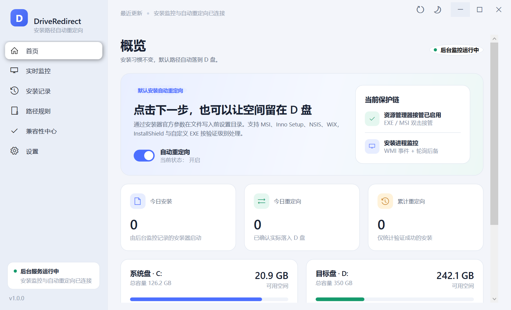

# DriveRedirect

DriveRedirect 是一款 Windows 安装路径自动重定向管理器。它在用户双击安装包时识别安装器类型，并在安装器可靠支持的前提下，把原本写入 C 盘的默认安装目录改为 D 盘对应目录。用户仍然可以按原来的习惯点击「下一步」「默认安装」或「立即安装」，不需要手动修改路径。

> 固定目标盘：`D:`。不自动切换到 E: 或其他磁盘。



## 核心原理

DriveRedirect 不使用进程注入、不终止安装器、不安装文件系统过滤驱动，也不会把安装器重启一次来“碰运气”。它采用安装框架本身支持的受控启动方式：

1. 后台服务 `DriveRedirect Service` 以 LocalSystem 运行，并启用资源管理器双击接管。
2. 用户双击 `.exe` / `.msi` 时，`DriveRedirect.Launcher` 通过本地命名管道向服务请求启动计划；管理操作使用服务生成的高熵令牌，管理管道仅允许本机管理员，启动器使用独立的 broker 管道且只能请求启动计划并受限速保护。
3. 服务识别安装器、评估兼容性、校验 D 盘状态，并由路径规则引擎决定是否重定向。
4. 启动器按适配器给出的参数启动原始安装器，由安装器自身完成文件写入：

   | 安装器 | 实际使用的机制 |
   |---|---|
   | MSI / WiX MSI | 公共目录属性；没有公共属性时生成 MST Transform，重挂私有 Directory 锚点并使用 `TARGETDIR=D:\` |
   | Inno Setup | `/DIR="D:\..."` |
   | NSIS | `/D=D:\...`（放在参数末尾） |
   | InstallShield Basic MSI | `/v"INSTALLDIR=..."` |
   | MSIX / AppX | 不修改，安全放行（由 Windows 部署子系统管理） |
   | 未知自定义 EXE | 不注入参数，安全放行；只有经过验证的自定义配置才允许自动处理 |

5. 安装结束后，服务检查目标目录和卸载注册表，记录真实安装位置、处理模式、兼容性等级和结果。

安装器未可靠支持路径改写时，DriveRedirect 会进入辅助模式或安全放行模式，不会为了覆盖率破坏安装器原有逻辑。

## 已实测的核心场景

在 Windows 10 22H2 x64 实机上，通过安装后的 `DriveRedirect.Launcher` 启动测试安装包，并全程使用默认页面：

- Inno Setup 测试包：向导「Select Destination Location」直接显示 `D:\Program Files (x86)\Acme Inno`，连续按回车通过默认页面后安装成功；数据库记录 `Redirected`，验证来源 `filesystem`，退出码 0。
- MSI 公共属性测试包：`D:\Program Files\AcmeExplicit`，`Redirected`。
- MSI 私有 Directory + MST 测试包：`D:\Program Files\AcmePrivate`，`Redirected`，兼容性 Medium。
- NSIS 测试包：`D:\Program Files (x86)\AcmeNsis`，`Redirected`。
- 文件关联链路：通过 ShellExecute 启动 NSIS 安装包时，`exefile` 关联实际进入 `DriveRedirect.Launcher`，自动追加 `/D=...` 后安装到 D 盘，记录 `Redirected`。

交互式 Inno 默认安装的界面证据见 [08-inno-default-path-crop.png](docs/screenshots/08-inno-default-path-crop.png)。完整测试结果与未覆盖项见 [docs/TEST-REPORT.md](docs/TEST-REPORT.md)。

## 系统要求

- Windows 10 22H2 x64 或 Windows 11 x64（本项目在 Windows 10 22H2 build 19045 实机验证）。
- D: 必须是存在、已就绪、可写、剩余空间足够的本地固定磁盘。
- 安装需要管理员权限。安装后的桌面程序也必须以管理员身份运行（清单已设置 `requireAdministrator`）。
- 程序为 self-contained 发布，不要求目标机器另装 .NET 运行时。

## 安装

交付安装包：`artifacts/release/DriveRedirect-1.0.0-x64.msi`  
构建副本：`installer/DriveRedirect.msi`  
SHA-256：`CD82E4A22102B233D14FB1DAC3504D47DC7799ED1A33B13CD506BB4F351C5E1B`

1. 运行上述 MSI。
2. 接受 UAC。安装程序会：
   - 安装到 `C:\Program Files\DriveRedirect`；
   - 创建并自动启动 `DriveRedirect Service`（LocalSystem，自动启动）；
   - 创建开始菜单和公共桌面快捷方式；
   - 由服务启用 EXE/MSI 双击接管。
3. 启动桌面上的 DriveRedirect。

安装包当前没有商业代码签名证书。Windows SmartScreen 可能显示“未知发布者”，这是未签名安装包的系统提示，不影响程序功能。

## 使用

1. 打开「首页」，确认后台服务、自动重定向开关和 D 盘状态正常。
2. 像平时一样双击软件安装包。
3. 对已可靠支持的安装器，直接点击「下一步 / 默认安装 / 立即安装」即可；向导中显示的默认目录已经是 D 盘路径。
4. 在「实时监控」查看当前安装器、原始路径、目标路径和处理结果；在「安装记录」搜索、排序、筛选历史。
5. 在「路径规则」维护路径映射、白名单、黑名单和系统保护目录。
6. 在「兼容性中心」查看适配器、兼容等级和失败原因。
7. 在「设置」调整开机启动、后台运行、通知、日志级别、MSI Transform 回退、AppData 重定向开关、日志导出、数据库备份和异常诊断。

### 辅助模式和安全放行

- 辅助模式：安装器不能可靠自动改写目录时，启动前提示推荐 D 盘路径；用户确认后安装器按原逻辑启动，由用户在安装界面选择该路径。
- 安全放行：无法识别或存在兼容风险时，不修改参数，正常安装并记录原因。

这比“所有安装器一律强行改路径”覆盖范围小，但不会破坏安装器逻辑、更新和卸载。

## 数据与日志

数据目录：`C:\ProgramData\DriveRedirect`

| 路径 | 内容 |
|---|---|
| `driveredirect.db` | SQLite：安装历史、规则、设置、安装器观察记录、异常记录 |
| `logs\service-YYYYMMDD.log` | Serilog 服务日志，按天滚动 |
| `logs\msi-<session>.log` | 每个 MSI 会话的 Windows Installer 详细日志 |
| `transforms\*.mst` | MSI 私有目录 Transform |
| `ipc.token` | 本机 IPC 认证令牌，受 NTFS ACL 保护 |
| `shell-backup.json` | 接管前的原始 EXE/MSI 关联，卸载时用于恢复 |

日志可在「设置」中导出为 ZIP；数据库可备份。卸载默认保留上述数据目录，便于审计和排障；如需彻底清除，手动删除该目录。

## 构建

### 依赖

- .NET SDK 10.0.4xx
- WiX Toolset 5（`wix.exe`）
- 可选：Inno Setup 7、NSIS（仅生成测试安装包时需要）

### 编译与测试

```powershell
dotnet build DriveRedirect.slnx -c Debug
dotnet test tests\DriveRedirect.Tests\DriveRedirect.Tests.csproj -c Debug
```

### 发布与打包

```powershell
dotnet publish src\DriveRedirect.Service\DriveRedirect.Service.csproj -c Release -r win-x64 --self-contained true -o artifacts\stage
dotnet publish src\DriveRedirect.Launcher\DriveRedirect.Launcher.csproj -c Release -r win-x64 --self-contained true -o artifacts\stage
dotnet publish src\DriveRedirect.Desktop\DriveRedirect.Desktop.csproj -c Release -r win-x64 --self-contained true -o artifacts\stage

powershell -NoProfile -ExecutionPolicy Bypass -File installer\generate-files.ps1

$stage = (Resolve-Path 'artifacts\stage').Path
wix build installer\DriveRedirect.Installer.wxs installer\GeneratedFiles.wxs `
  -o installer\DriveRedirect.msi -arch x64 -d SourceDir="$stage"
```

### 测试安装包

测试样本工程位于：

- `tests/fixtures/wix/`：WiX MSI（公共属性和私有 Directory 两种）
- `tests/fixtures/inno/`：Inno Setup 7 脚本与产物
- `tests/fixtures/nsis/`：NSIS 脚本与产物

构建 Inno：

```powershell
& "$env:LOCALAPPDATA\Programs\Inno Setup 7\ISCC.exe" tests\fixtures\inno\AcmeInno.iss
```

构建 NSIS：

```powershell
& 'C:\Program Files (x86)\NSIS\makensis.exe' tests\fixtures\nsis\AcmeNsis.nsi
```

## 项目结构

```text
src/
  DriveRedirect.Core/           模型、路径规则引擎、安装器识别基础、IPC 契约
  DriveRedirect.Infrastructure/ SQLite、Serilog 接入、安装器检测/适配器、MST、验证、Shell 接管
  DriveRedirect.Service/        Windows Service、WMI 进程监控、命名管道 IPC
  DriveRedirect.Launcher/       双击启动拦截器与关联恢复
  DriveRedirect.Desktop/        WPF MVVM 管理端
tests/
  DriveRedirect.Tests/          单元测试与 MSI 夹具测试
  fixtures/                     可控测试安装包
installer/                      WiX MSI 工程与文件清单生成器
tools/                          CLI、UI 冒烟、UI 自动化等开发工具
docs/                           限制说明与测试报告
artifacts/                      构建产物、截图、安装日志
```

桌面端页面：首页、实时监控、安装记录、路径规则、兼容性中心、设置。支持浅色/深色/跟随系统主题，采用无边框 Windows 11 风格界面，并按显示器 DPI 自动适配窗口大小。

## 卸载

通过「设置 → 应用」或以下命令卸载：

```powershell
msiexec /x installer\DriveRedirect.msi
```

卸载会停止并删除服务、删除程序文件和快捷方式，并调用启动器恢复接管前的 EXE/MSI 关联。`C:\ProgramData\DriveRedirect` 数据目录默认保留。

## 已知限制

请务必阅读 [docs/LIMITATIONS.md](docs/LIMITATIONS.md)。最重要的三点：

1. Windows 没有通用机制能在任意安装器写入前修改其安装目录；DriveRedirect 只对使用受支持安装框架和参数的安装器自动重定向。
2. 双击接管依赖文件关联。通过命令行、更新器内部调用、服务进程或绕过 Shell 关联的启动不会被自动改写。
3. 不迁移已安装软件，不全局迁移 AppData，不修改系统保护的目录链接，不安装过滤驱动。

